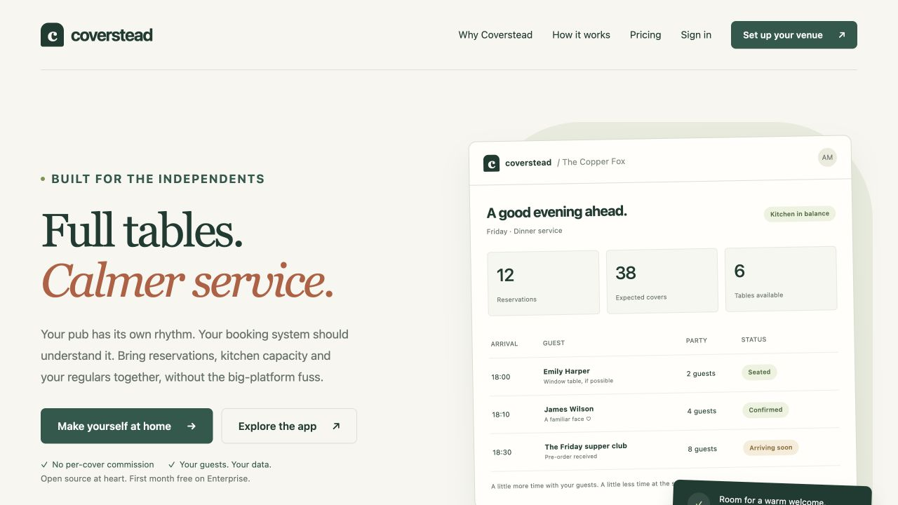

# Coverstead

**Full tables. Calmer service.**

Open-source reservation software for independent pubs, restaurants and hospitality venues. Plan your tables, pace the kitchen and give the team a clear picture of the next service.

[Visit Coverstead](https://coverstead.net) · [Try the demo](https://coverstead.net/demo) · [User manual](https://coverstead.net/manual) · [Installation guide](https://coverstead.net/install) · [Suggest an improvement](https://github.com/thewebsitenursery/coverstead/issues/new/choose) · [Contribute](CONTRIBUTING.md)



## Built for independent hospitality

Coverstead grew from the reservation app at The Red Lion in Kilsby. Alistair Nichols wanted to make a useful tool available to other independent venues, without a software licence fee or per-cover commission.

- **Bookings and walk-ins:** guest booking form, staff diary, search, amendments and cancellations.
- **Tables and kitchen capacity:** areas, allowed table combinations, arrival limits, dining durations and service closures.
- **Your venue:** guided setup, opening hours, menus, branding and guest information.
- **Your regulars:** customer history, consent records and staff-issued loyalty vouchers.
- **A clearer service:** printable service sheets, pre-order tracking and manual deposit records.
- **Team tools:** optional owner, manager and staff roles, reports and activity history.

## Pilot status

Version **0.1.0** is an early pilot. Rehearse bookings, email delivery and backup recovery on your own installation before using it for a real service. Read the [product status](docs/PRODUCT-STATUS.md) for implemented features and limitations.

The entire source, including the optional Enterprise administration modules, is [MIT-licensed](LICENSE). The planned managed service covers hosting, updates, backups and support: one free month, then £10 per venue per month or £100 per year. Coverstead is operated by Classicbikemerch Ltd.

Managed subscriptions currently work **only in Stripe test mode**. They take no real payment and do not provision a hosted venue. Guest online payments are disabled. Self-hosting does not require Stripe or a subscription.

## Try the demo locally

Use a maintained Node.js LTS release (Node 22 or 24) and npm. The application requires Node 20 or later. The demo uses synthetic data, binds to your computer and sends no email.

```sh
git clone https://github.com/thewebsitenursery/coverstead.git
cd coverstead
npm ci --ignore-scripts
npm run demo
```

Open <http://127.0.0.1:3100/admin> for the staff desk or <http://127.0.0.1:3100/book> for the booking form. Stop with Ctrl+C. Demo access bypasses normal staff authentication; keep it local.

## Set up your own venue

From the project folder, after installing dependencies:

```sh
node scripts/setup.js --url=http://localhost:3100
npm start
```

Open <http://localhost:3100/onboarding> and use the installation token printed by setup to create the owner account. Configuration is stored privately in `data/config.env`; `npm run token` retrieves the token again. Never publish that file or token.

The [installation manual](https://coverstead.net/install) covers Docker, HTTPS, venue setup and email. Each venue needs its own database and one Node process. The app writes SQLite snapshots through `sql.js`; it must not run multiple workers against one database. SMTP stays off until sender configuration is verified, and guest reservations stay closed until venue onboarding is complete.

## Help improve Coverstead

Venue feedback, bug reports, accessibility improvements, documentation and code contributions are welcome. Start with [CONTRIBUTING.md](CONTRIBUTING.md) and the [roadmap](docs/ROADMAP.md), or [open an issue](https://github.com/thewebsitenursery/coverstead/issues/new/choose). Discuss substantial changes before starting a pull request.

Please use synthetic examples and remove guest details, tokens and credentials from screenshots and logs. Report vulnerabilities privately using the [security policy](SECURITY.md).

If Coverstead would help another venue, share [coverstead.net](https://coverstead.net). A GitHub star helps other developers find the project.

## Development

```sh
npm test
npm run check
npm run release
```

Tests use isolated data and a fake Stripe transport; no payment keys are required. `npm test` runs `test/*.test.js`. Historical tests in `test/upstream` are reference material for the original application.

The release helper requires the system `zip` command and builds `public/downloads/coverstead-community.zip` from a source allowlist, excluding private configuration, databases, uploads and dependencies. Build it before serving the product website's download link.

| Area | Files |
| --- | --- |
| HTTP routes and booking lifecycle | `server.js`, `platform.js`, `crm.js` |
| Capacity, tables and venue configuration | `rules.js`, `venue.js`, `closures.js`, `walkins.js` |
| Persistence and transactions | `store.js` |
| Optional subscription pilot | `billing.js`, `public/billing.js` |
| Browser interface | `public/` — HTML, CSS and vanilla JavaScript |
| Setup, backups and packaging | `scripts/` |

## Documentation

- [Product status and boundaries](docs/PRODUCT-STATUS.md)
- [Operations, backup and recovery](docs/OPERATIONS.md)
- [Opalstack deployment template](docs/OPALSTACK.md)
- [Venue setup questionnaire](docs/VENUE-QUESTIONNAIRE.md)
- [Stripe subscription pilot](docs/STRIPE.md)
- [Contribution priorities](docs/ROADMAP.md)

## Licence

[MIT](LICENSE) · Copyright © 2026 Alistair Murray Nichols.
